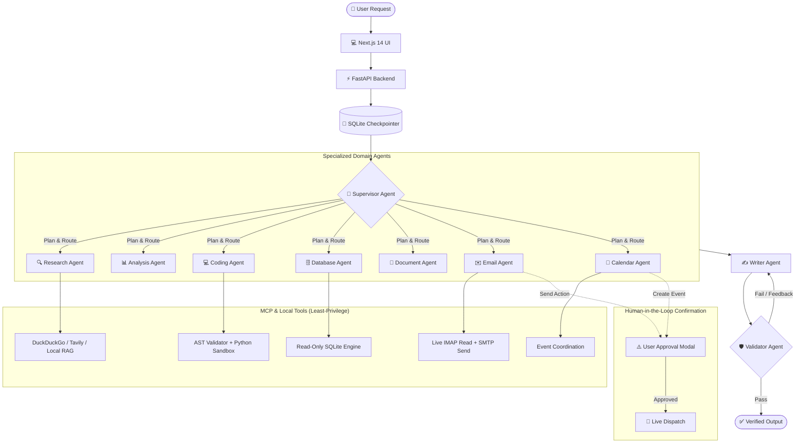

# 🤖 Multi-Agent AI Task Automation System

[](https://www.python.org/)
[](https://fastapi.tiangolo.com/)
[](https://nextjs.org/)
[](https://github.com/langchain-ai/langgraph)
[](https://ollama.com/)
[](https://groq.com/)
[](https://modelcontextprotocol.io/)
[](https://opensource.org/licenses/MIT)

An enterprise-grade, autonomous **Multi-Agent Task Automation Platform** powered by **LangGraph**, **FastAPI**, and **Next.js 14**. The system coordinates **9 specialized AI agents** under a dynamic **Supervisor**, executes tools via the **Model Context Protocol (MCP)**, supports **Human-in-the-Loop (HITL)** approvals, and features a **Hybrid LLM Engine** capable of running **100% offline via local Ollama** or ultra-fast in the cloud using **Groq, OpenAI, OpenRouter, and Grok**.

---

## 📑 Table of Contents

- [System Architecture](#-system-architecture)
- [Specialized Agents](#-specialized-agents)
- [Key Features](#-key-features)
- [MCP Tools Ecosystem](#-mcp-tools-ecosystem)
- [Hybrid LLM Engine](#-hybrid-llm-engine)
- [Project Directory Structure](#-project-directory-structure)
- [Getting Started](#-getting-started)
  - [Prerequisites](#prerequisites)
  - [1. Backend Setup](#1-backend-setup)
  - [2. Frontend Setup](#2-frontend-setup)
  - [3. Local LLM Setup (Optional)](#3-local-llm-setup-optional)
- [Environment Configuration](#-environment-configuration)
- [API Reference](#-api-reference)
- [Testing & Quality Assurance](#-testing--quality-assurance)
- [License](#-license)

---

## 🏛 System Architecture

The platform uses a **stateful graph architecture** orchestrated by **LangGraph**. Requests are dynamically planned by the **Supervisor Agent**, which decomposes tasks into a directed execution plan, delegates work to domain-specific agents, and routes through an automated **Validator Agent** before completing.



---

## 👥 Specialized Agents

Each agent operates under a strict **least-privilege permission model**, receiving only the specific tools, prompt constraints, and context required for its domain:

| Agent | Responsibility | Permitted Tools & Capabilities |
| :--- | :--- | :--- |
| **🧠 Supervisor** | Task decomposition, dynamic agent selection, dependency routing, and execution plan formulation. | Workflow state control, agent dispatching |
| **🔍 Research** | Real-time web investigation and document knowledge retrieval. | `web_search`, `calculator`, Local RAG Vector Store |
| **📊 Analysis** | Quantitative evaluation, cross-agent data synthesis, pattern detection. | `calculator`, Multi-turn metric aggregation |
| **💻 Coding** | Software engineering, syntax validation, script execution. | `validate_python_code` (AST), `execute_sandboxed_python` |
| **🗄️ Database** | Safe relational schema inspection, SQL queries (SELECT only). | `list_tables`, `describe_table`, `execute_read_query`, `get_sample_rows` |
| **📄 Document** | Technical report generation and file persistence. | Document Authoring, File System Exporter (`.md`, `.txt`) |
| **✉️ Email** | Live inbox search, email body retrieval, drafting, confirmed dispatch. | `search_emails`, `get_email`, `draft_email`, `send_email` (*HITL Protected*) |
| **📅 Calendar** | Agenda lookup, free-slot computation, event creation/updates. | `list_events`, `get_event`, `find_free_time`, `create_event` (*HITL Protected*) |
| **✍️ Writer** | Final multi-agent report compilation and conversational response synthesis. | Multi-agent context aggregation (*Strict code suppression for conceptual queries*) |
| **🛡️ Validator** | Multi-domain safety, factual verification, SQL query audit, and quality gating. | Verification checklist, automated revision feedback loop |

---

## ✨ Key Features

- **Dynamic Supervisor Planning**: Tasks are not forced through static sequential pipelines. The Supervisor plans only the required agents on the fly based on the user's intent.
- **Hybrid LLM Provider Support**:
  - **Local Offline**: Runs 100% locally via **Ollama** (`qwen3.5:4b`, `llama3.2`, etc.) with zero external API key requirements.
  - **Cloud Ultra-Fast**: Sub-second LPU inference with **Groq** (`openai/gpt-oss-20b`, `llama-3.3-70b-versatile`).
  - **Multi-Provider Failover**: Automatic round-robin rotation across Groq, OpenAI, OpenRouter, and xAI Grok with intelligent rate-limit backoff.
- **Model Context Protocol (MCP)**: Native support for 17 standard tools through direct sub-20ms in-process dispatch with standalone SSE server support.
- **Human-in-the-Loop (HITL) Authorization**: Critical side-effects (e.g. sending real emails or booking calendar events) produce structured confirmation requests that pause the workflow until explicitly approved by the user.
- **Multi-Turn Persistent Memory**: Uses SQLite checkpoints (`checkpoints.db`) to retain complete conversational history across threads, allowing natural follow-ups and context retention.
- **Self-Healing Validation Loop**: Output is audited by the Validator across domain checklists (factual consistency, AST code validity, read-only SQL safety). If flaws are detected, the workflow automatically routes back to the Writer with specific feedback.
- **Strict Code Suppression Rules**: Educational and conceptual questions (*"Explain MCP"*, *"What is machine learning?"*) receive thorough conceptual breakdowns without unsolicited code blocks. Code is strictly emitted only when explicitly requested.

---

## 🛠 MCP Tools Ecosystem

The system registers **17 standard tools** accessible by agents via the Model Context Protocol:

```text
├── Core & Search
│   ├── calculator                  # Safe mathematical evaluation
│   ├── web_search                  # Real-time web search (DuckDuckGo / Tavily / Serper)
│   └── search_images               # Authentic diagram and image search (Wikimedia / Wikipedia)
├── Database (Read-Only Safety)
│   ├── list_tables                 # Discover database tables
│   ├── describe_table              # Inspect table columns and types
│   ├── execute_read_query          # Safe SELECT SQL execution
│   └── get_sample_rows             # Preview sample records
├── Email Communication
│   ├── search_emails               # Search live Gmail inbox via IMAP or local store
│   ├── get_email                   # Fetch full email message by ID
│   ├── draft_email                 # Prepare draft email (safe, automatic)
│   └── send_email                  # Dispatch live email via SMTP (requires HITL confirmation)
├── Calendar & Scheduling
│   ├── list_events                 # List scheduled meetings and events
│   ├── get_event                   # Retrieve event metadata by ID
│   ├── find_free_time              # Locate open calendar availability
│   └── create_event                # Schedule calendar event (requires HITL confirmation)
└── Coding Sandbox
    ├── validate_python_code        # Python syntax validation via AST parser
    └── execute_sandboxed_python    # Secure isolated code execution with timeout capping
```

---

## ⚡ Hybrid LLM Engine

Switch between local offline privacy and ultra-fast cloud performance with a single variable in `.env`:

```env
# 100% Local Offline (Zero API Keys Needed)
LLM_PROVIDER=ollama
OLLAMA_BASE_URL=http://127.0.0.1:11434
OLLAMA_MODEL=qwen3.5:4b

# Cloud Ultra-Fast (Sub-second response)
LLM_PROVIDER=groq
GROQ_MODEL=openai/gpt-oss-20b

# Multi-Provider Round-Robin (Automatic failover & rate-limit resilience)
LLM_PROVIDER=round_robin
```

---

## 📂 Project Directory Structure

```text
Multi-Agent-AI-System/
├── backend/
│   ├── app/
│   │   ├── agents/                 # Specialized Agent implementations
│   │   │   ├── supervisor.py       # Dynamic task planning & routing
│   │   │   ├── researcher.py       # Web search & RAG retrieval
│   │   │   ├── analyst.py          # Data analysis & synthesis
│   │   │   ├── coder.py            # Code authoring & validation
│   │   │   ├── database_agent.py   # Safe database operations
│   │   │   ├── document_agent.py   # Document export & management
│   │   │   ├── email_agent.py      # Gmail IMAP/SMTP coordination
│   │   │   ├── calendar_agent.py   # Calendar & scheduling logic
│   │   │   ├── writer.py           # Synthesis & response authoring
│   │   │   └── validator.py        # Multi-domain policy auditor
│   │   ├── graph/                  # LangGraph state machine & workflow
│   │   │   ├── state.py            # GraphState typed dictionary
│   │   │   └── workflow.py         # Graph compilation & edge routing
│   │   ├── services/               # Core infrastructure services
│   │   │   ├── llm_service.py      # Multi-provider LLM engine (Ollama/Groq/OpenAI)
│   │   │   ├── mcp_client.py       # Model Context Protocol client
│   │   │   └── checkpoint_service.py # SQLite state checkpointing
│   │   ├── tools/                  # 17 domain tools (Email, DB, Calendar, Sandbox)
│   │   ├── rag/                    # Vector store & document ingestion
│   │   ├── config.py               # Dynamic settings & environment management
│   │   └── main.py                 # FastAPI application & streaming endpoints
│   ├── mcp_server/                 # Standalone MCP SSE/stdio server
│   ├── tests/                      # Pytest test suite (100+ unit & integration tests)
│   ├── requirements.txt            # Python dependencies
│   └── .env.example                # Template for backend environment variables
├── frontend/
│   ├── app/                        # Next.js 14 App Router
│   ├── components/                 # UI components
│   │   ├── chat/                   # Interactive chat & agent step timeline
│   │   ├── agents/                 # Live agent status & execution traces
│   │   ├── common/                 # Human-in-the-loop confirmation modals
│   │   └── settings/               # System configuration & theme switcher
│   ├── lib/                        # API client & streaming utilities
│   ├── package.json                # Frontend dependencies
│   └── .env.example                # Template for frontend environment variables
├── .gitignore                      # Security-enforced gitignore (blocks all secrets)
└── README.md                       # Master system documentation
```

---

## 🚀 Getting Started

### Prerequisites

- **Python**: `3.11+`
- **Node.js**: `18.x` or `20.x` (with `npm` or `pnpm`)
- **Git**: Installed and configured
- **Ollama** *(Optional, for 100% offline local LLM)*: [Download Ollama](https://ollama.com/)

---

### 1. Backend Setup

```bash
# 1. Clone the repository
git clone https://github.com/Kunj-Vadhiya/Multi-Agent-AI-System.git
cd Multi-Agent-AI-System/backend

# 2. Create and activate a virtual environment
python -m venv venv

# On Windows (PowerShell):
.\venv\Scripts\Activate.ps1
# On macOS / Linux:
source venv/bin/activate

# 3. Install dependencies
pip install -r requirements.txt

# 4. Configure environment variables
cp .env.example .env
# Edit .env with your preferred provider (Ollama, Groq, etc.)

# 5. Start the FastAPI backend
uvicorn app.main:app --host 127.0.0.1 --port 8000 --reload
```

The backend will start at: `http://127.0.0.1:8000`  
Interactive Swagger API docs available at: `http://127.0.0.1:8000/docs`

---

### 2. Frontend Setup

In a new terminal window:

```bash
cd Multi-Agent-AI-System/frontend

# 1. Install dependencies
npm install

# 2. Configure environment
cp .env.example .env.local

# 3. Start the Next.js development server
npm run dev
```

Open your browser and navigate to: `http://localhost:3000`

---

### 3. Local LLM Setup (Optional)

To run entirely offline without external API keys:

```bash
# 1. Install Ollama and pull your desired model (e.g., Qwen 3.5 4B or Llama 3.2)
ollama run qwen3.5:4b

# 2. In backend/.env, set:
LLM_PROVIDER=ollama
OLLAMA_BASE_URL=http://127.0.0.1:11434
OLLAMA_MODEL=qwen3.5:4b
```

---

## ⚙️ Environment Configuration

| Variable | Description | Default / Example |
| :--- | :--- | :--- |
| `LLM_PROVIDER` | Active LLM strategy: `ollama`, `groq`, `openai`, `openrouter`, `grok`, `round_robin` | `ollama` |
| `OLLAMA_BASE_URL` | Local Ollama endpoint | `http://127.0.0.1:11434` |
| `OLLAMA_MODEL` | Local Ollama model name | `qwen3.5:4b` |
| `GROQ_API_KEYS` | Comma-separated Groq API keys for rotation | `gsk_key1,gsk_key2` |
| `GROQ_MODEL` | Cloud Groq model | `openai/gpt-oss-20b` |
| `OPENAI_API_KEYS` | OpenAI API keys | `sk-proj-...` |
| `SEARCH_PROVIDER` | Web search engine: `auto`, `duckduckgo`, `tavily`, `serper` | `auto` |
| `MCP_TRANSPORT` | MCP execution mode: `auto` (direct in-process), `sse`, `stdio` | `auto` |
| `SMTP_HOST` | Outgoing email server | `smtp.gmail.com` |
| `SMTP_PORT` | SMTP port | `587` |
| `SMTP_USER` | Gmail username | `your_email@gmail.com` |
| `SMTP_PASSWORD` | Google App Password (16 characters) | `abcd efgh ijkl mnop` |
| `IMAP_HOST` | Incoming email server for reading inbox | `imap.gmail.com` |
| `IMAP_PORT` | IMAP SSL port | `993` |

---

## 📡 API Reference

| Method | Endpoint | Description |
| :--- | :--- | :--- |
| `GET` | `/health` | System health and service availability check |
| `POST` | `/chat` | Standard multi-agent workflow invocation |
| `POST` | `/chat/stream` | Real-time Server-Sent Events (SSE) streaming of agent reasoning steps |
| `POST` | `/chat/confirm` | Submit Human-in-the-Loop decision (`APPROVED` or `REJECTED`) |
| `POST` | `/documents/upload` | Ingest PDF, text, or markdown files into the local RAG vector store |
| `GET` | `/threads/{thread_id}` | Retrieve persistent conversation state and execution history |
| `DELETE` | `/threads/{thread_id}` | Purge thread checkpoints and memory |

---

## 🧪 Testing & Quality Assurance

The codebase includes comprehensive unit and integration tests covering multi-agent coordination, key rotation, MCP execution, and SQLite checkpointing:

```bash
# Run the entire test suite
pytest backend/tests -v

# Run key rotation and provider failover tests
pytest backend/tests/test_key_rotation.py -v

# Run MCP client & tool execution tests
pytest backend/tests/test_mcp_client.py -v

# Run full LangGraph multi-agent workflow tests
pytest backend/tests/test_workflow.py -v
```

---

## 📄 License

This project is licensed under the **MIT License**. See the [LICENSE](LICENSE) file for details.
